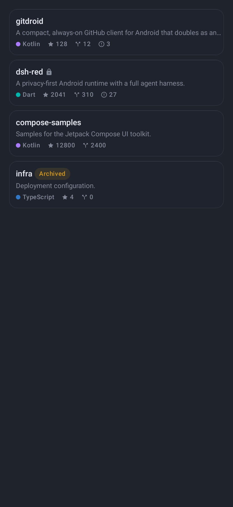
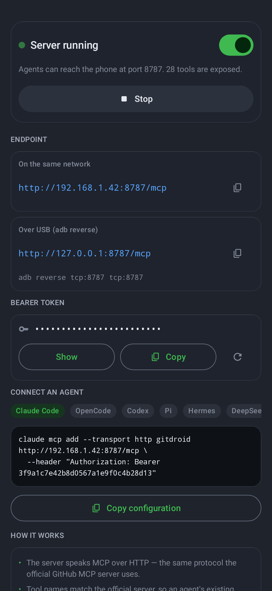
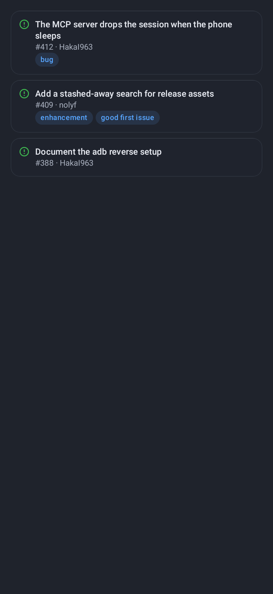

# GitDroid

**Your GitHub, in your pocket — and on the wire for your agents.**

GitDroid is a compact GitHub client for Android that doubles as an **MCP
server**: your phone hosts a real Model Context Protocol endpoint, and any AI
agent — Claude Code, OpenCode, Codex, Pi, Hermes, a DeepSeek harness plugin —
can drive the GitHub account that is signed in on the phone.

<p align="center">
  <em>Repositories · code · issues · pull requests · Actions · releases · search · downloads · an MCP server for your agents</em>
</p>

| Repositories | The MCP dashboard |
|---|---|
|  |  |

---

## Why another GitHub app

The official GitHub Android app and github.com both fail the same two ways on
a phone:

**1. The session dies.** Background the app for two minutes and the page
reloads. You lose the tab, the branch, the search, the half-written issue
body. GitDroid keeps the whole session warm — the token lives in the Android
Keystore, the API client holds a warm connection pool, every list is cached
on disk, and the MCP server runs in a foreground service so the process is
never reclaimed.

**2. The surface is a web page.** Everything is a form. GitDroid is native,
dense and thumb-first: a repository switcher that keeps every repo's scroll
position and branch selection alive, a code browser with an in-app editor
that commits straight back to the branch you are on, and a search that covers
**public** repositories and code — the one thing the official app genuinely
cannot do.

---

## The MCP half

This is the part that makes GitDroid more than a client.

The app runs a real MCP server (`dev.gitdroid.app.mcp`) over HTTP, speaking
JSON-RPC 2.0 with the `initialize` / `tools/list` / `tools/call` handshake
plus the `resources` and `prompts` surfaces. It is bound to `0.0.0.0`, guarded
by a per-install bearer token, and it stays alive in a foreground service.

**28 tools**, named exactly like the official GitHub MCP server, so an agent
that already knows how to drive GitHub needs no new instructions:

| Area | Tools |
|---|---|
| Read | `list_repositories` `get_repository` `get_file_contents` `get_repository_tree` `list_branches` `list_commits` `list_tags` `list_releases` |
| Search | `search_repositories` `search_code` |
| Write | `create_repository` `update_repository` `delete_repository` `fork_repository` `create_or_update_file` `delete_file` `create_branch` |
| Issues | `list_issues` `create_issue` `update_issue` |
| Pull requests | `list_pull_requests` `create_pull_request` `merge_pull_request` |
| Actions | `list_workflows` `list_workflow_runs` `rerun_workflow` `cancel_workflow_run` `dispatch_workflow` |

### Connecting an agent

The MCP tab in the app shows the URL, the token and a ready-to-paste snippet
for every supported client:

```bash
# Claude Code
claude mcp add --transport http gitdroid http://<phone-ip>:8787/mcp \
  --header "Authorization: Bearer <token>"
```

```jsonc
// OpenCode — opencode.json
{
  "mcp": {
    "gitdroid": {
      "type": "remote",
      "url": "http://<phone-ip>:8787/mcp",
      "enabled": true,
      "headers": { "Authorization": "Bearer <token>" }
    }
  }
}
```

```toml
# Codex — ~/.codex/config.toml
[mcp_servers.gitdroid]
url = "http://<phone-ip>:8787/mcp"
http_headers = { "Authorization" = "Bearer <token>" }
```

Over USB, forward the port and use `127.0.0.1`:

```bash
adb reverse tcp:8787 tcp:8787
```

`Pi`, `Hermes`, a `DeepSeek` harness plugin and a generic JSON-RPC snippet
live in the app's MCP tab too, and in [`docs/MCP.md`](docs/MCP.md).

---

## Features

**Session**
- GitHub OAuth **device flow** sign-in — no browser redirect, works entirely in-app
- Personal access token sign-in as an alternative
- Tokens sealed with an AES-256-GCM key in the Android Keystore
- Disk cache for every list: screens render from cache instantly, then reconcile

**Repositories**
- Compact, dense repository list with a language dot, stars, forks and issue count
- Pinned rail and a quick-switcher sheet that keeps every repo's state alive
- Create, rename, archive, delete, fork, star, change visibility, edit topics
- Per-repo branch selection that survives restarts

**Code**
- File tree browser with an in-app editor that commits back to your branch
- Markdown rendered, code in monospace, images previewed
- Download any file, or the whole repository as a zip, to shared storage

**Issues, pull requests, Actions, releases**
- Issue list with labels, pull request list with diff stats
- Workflow runs with their status, re-run, cancel and dispatch
- Releases with their assets

**Search**
- Public repository search and public code search

**MCP**
- A real MCP server with 28 tools, a bearer token and per-agent setup snippets

---

## Building

The APK is built by **GitHub Actions** — no local Gradle, Android SDK or NDK
is required:

```bash
git push origin main
gh run list                    # watch the "Android APK" workflow
gh run download                 # grab the artifact
```

To build locally instead, install the Android SDK (platform 36, build-tools
36.0.0) and JDK 17, then:

```bash
./gradlew :app:assembleRelease
```

The release build is signed with the debug key when `key.properties` is
absent, so CI always produces an installable artifact. To sign a real
release, add `key.properties` to the repository root:

```properties
storeFile=release.jks
storePassword=…
keyAlias=…
keyPassword=…
```

### Versions

| Component | Version |
|---|---|
| Gradle | 8.13 |
| Android Gradle Plugin | 8.10.1 |
| Kotlin | 2.2.21 |
| Compose BOM | 2025.06.01 (UI 1.8.3, Material 3 1.3.2) |
| compileSdk / targetSdk / minSdk | 36 / 36 / 26 |

---

## Using your own OAuth app

The app ships with a public OAuth **client id** — device flow needs a client
id but no client secret, which is why it is safe to embed. Register your own
OAuth App at **Settings → Developer settings → OAuth Apps**, tick
*Device flow*, and replace `DeviceFlowClient.CLIENT_ID` in
[`core/auth/DeviceFlowClient.kt`](app/src/main/java/dev/gitdroid/app/core/auth/DeviceFlowClient.kt).

The requested scope is `repo workflow read:org`.

---

## Documentation

- [docs/ARCHITECTURE.md](docs/ARCHITECTURE.md) — how the app is put together
- [docs/MCP.md](docs/MCP.md) — the MCP server, its tools and its transports
- [docs/AGENTS.md](docs/AGENTS.md) — how to work on this repository
- [integrations/README.md](integrations/README.md) — connecting every agent
- [docs/screenshots/](docs/screenshots/) — the rendered screens

## Screens

| Issues | Actions |
|---|---|
|  |  |

## License

MIT.
